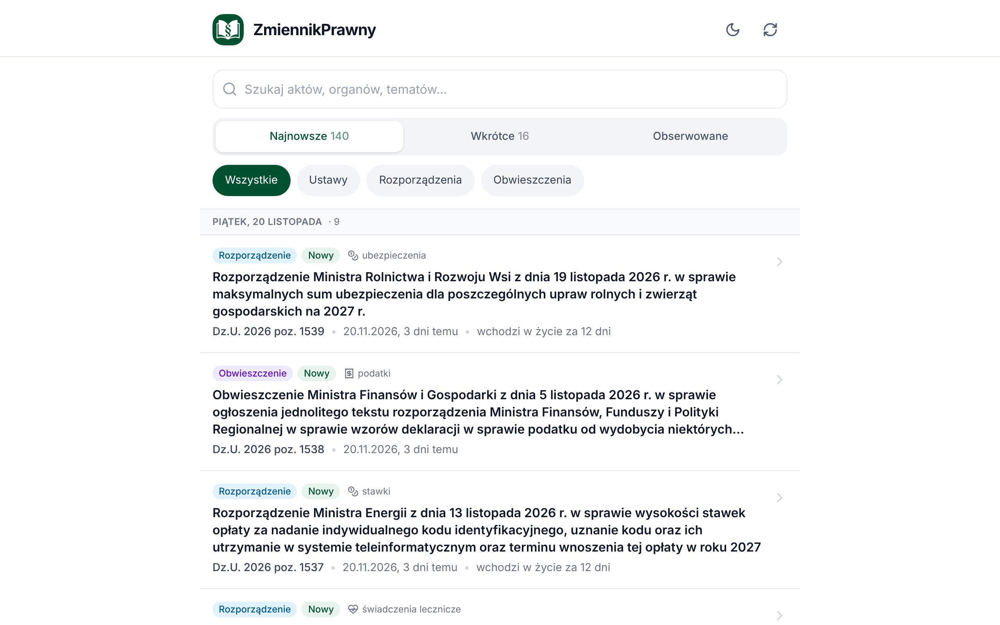
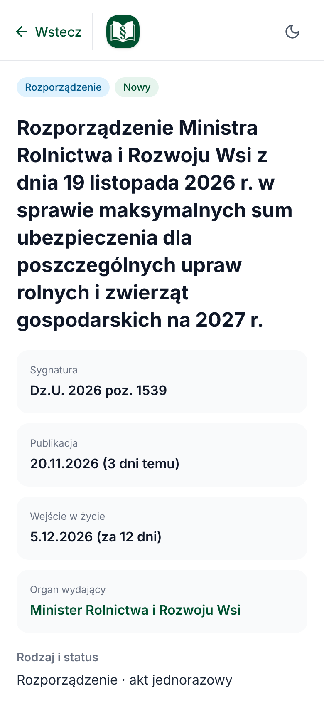
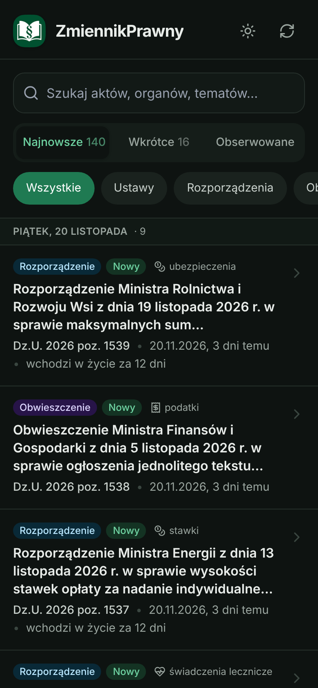

<div align="center">
  
  <h1>ZmiennikPrawny</h1>
  <p>Nowe ustawy, rozporządzenia i obwieszczenia z Dziennika Ustaw RP w jednym miejscu, zaraz po publikacji.</p>

  <p>
    
    
    
    
    
    
    <br />
    
    
    
  </p>

  <p>
    <a href="https://zmiennikprawny.vercel.app/"></a>
    &nbsp;
    <a href="https://zmiennikprawny.pl"></a>
  </p>

  

  <br /><br />

  
  &nbsp;
  
  &nbsp;
  
</div>

---

## Spis treści

- [Historia projektu](#historia-projektu)
- [Funkcje](#funkcje)
- [Technologie](#technologie)
- [Uruchomienie lokalne](#uruchomienie-lokalne)
- [Struktura projektu](#struktura-projektu)
- [Źródło danych (API Sejmu RP)](#źródło-danych-api-sejmu-rp)
- [iPhone i PWA](#iphone-i-pwa)
- [Licencja i prawa autorskie](#licencja-i-prawa-autorskie)

## Historia projektu

| Data | Wersja | Co się zmieniło |
|---|---|---|
| wrzesień 2025 | Alfa | Początek prac, wewnętrzne testy i fundamenty aplikacji |
| listopad 2025 | Beta | Pierwsza publiczna wersja, pierwsze opinie użytkowników |
| maj 2026 | v1.0 | Pierwsza wersja stabilna: dopracowany interfejs i UX |
| listopad 2026 | v1.2 | Duża aktualizacja: zakładki „Wkrótce” i „Obserwowane”, grupowanie po dniach, linki do aktów, klikalne tematy i organy, ikonki tematów, tryb ciemny, data wejścia w życie i organ wydający z ISAP, naprawa wyszukiwarki, pełne PWA, ok. 4× mniej pobieranych danych |

## Funkcje

- **Najnowsze akty** – ustawy, rozporządzenia i obwieszczenia z ostatnich 30 dni, pogrupowane według dnia publikacji
- **Wyszukiwarka** – szuka w tytule, sygnaturze, organie i tematach; trafione frazy są podświetlone
- **Filtry** – Wszystkie / Ustawy / Rozporządzenia / Obwieszczenia
- **Wkrótce w życie** – akty, które zaczną obowiązywać w ciągu 14 dni, z odliczaniem dni
- **Obserwowane tematy** – własna lista słów (zapisana tylko w przeglądarce, bez konta) z oznaczeniem nowych aktów od ostatniej wizyty
- **Klikalne tematy i organy** – jedno kliknięcie pokazuje wszystkie akty z danym tematem albo od danego organu; każdy temat ma swoją ikonkę
- **Szczegóły aktu** – sygnatura, data publikacji i wejścia w życie, organ, tematy, link do PDF i do strony w ISAP, kopiowanie sygnatury i linku
- **Linki do aktów** – każdy akt ma własny adres (np. `/#/DU/2026/1539`), działa przycisk „wstecz”
- **Tryb ciemny** – automatycznie według systemu albo ręcznie
- **PWA** – instalacja na ekranie głównym telefonu, dopasowanie do notcha i Dynamic Island

## Technologie

| | |
|---|---|
| Interfejs | React 18 + TypeScript |
| Style | Tailwind CSS v4 |
| Budowanie | Vite 6 |
| Ikony | Lucide React |
| Dane | API Sejmu RP (ELI) |
| Hosting | Vercel |

## Uruchomienie lokalne

Wymagania: **Node.js 18+** i **pnpm**.

```bash
git clone https://github.com/piowerb/ZmiennikPrawny.git
cd ZmiennikPrawny
pnpm install
pnpm run dev
```

Aplikacja będzie dostępna pod adresem `http://localhost:5173`.

Wersja produkcyjna:

```bash
pnpm run build
```

Zbudowane pliki trafią do folderu `dist/`.

## Struktura projektu

```text
src/
├── app/
│   ├── App.tsx                 # układ, zakładki, filtry, routing (#/DU/rok/pozycja)
│   ├── components/
│   │   ├── ActList.tsx         # lista aktów pogrupowana po dniach
│   │   ├── ActDetail.tsx       # szczegóły aktu
│   │   ├── TopicsPanel.tsx     # obserwowane tematy
│   │   └── ui/                 # komponenty shadcn/ui
│   ├── lib/
│   │   ├── text.tsx            # daty, kategorie, wyszukiwanie, podświetlanie
│   │   ├── topicIcon.tsx       # ikonki tematów
│   │   └── storage.ts          # zapis ustawień w przeglądarce
│   ├── services/
│   │   └── isapService.ts      # pobieranie danych z API Sejmu
│   └── types/
│       └── LegalAct.ts         # typ aktu prawnego
├── imports/                    # logo i zrzut ekranu
└── styles/                     # Tailwind i motyw
public/                         # manifest PWA i ikony
docs/                           # zrzuty ekranu do README
```

## Źródło danych (API Sejmu RP)

Aplikacja korzysta z publicznego API Sejmu RP w standardzie ELI (European Legislation Identifier).

- Zapytanie używane w aplikacji: `https://api.sejm.gov.pl/eli/acts/search?publisher=DU&pubDateFrom={data}` – akty z ostatnich 30 dni, razem z datą wejścia w życie, organem wydającym i słowami kluczowymi
- PDF aktu pochodzi z ISAP, np. `https://isap.sejm.gov.pl/isap.nsf/download.xsp/WDU20260001539/O/D20261539.pdf`
- Dokumentacja: [api.sejm.gov.pl/eli_pl.html](https://api.sejm.gov.pl/eli_pl.html)
- Portal ISAP: [isap.sejm.gov.pl](https://isap.sejm.gov.pl/)

Przykład:

```bash
curl "https://api.sejm.gov.pl/eli/acts/DU/2026/1539"
```

Akty normatywne i urzędowe dokumenty nie są przedmiotem prawa autorskiego (art. 4 ustawy o prawie autorskim i prawach pokrewnych). ZmiennikPrawny nie jest serwisem Sejmu RP ani Rządowego Centrum Legislacji, a informacje w aplikacji nie stanowią porady prawnej. Wiążący jest wyłącznie tekst opublikowany w Dzienniku Ustaw.

## iPhone i PWA

Aplikacja działa w przeglądarce, ale można ją też dodać do ekranu głównego jak zwykłą aplikację:

1. Otwórz [zmiennikprawny.vercel.app](https://zmiennikprawny.vercel.app/) w Safari
2. Stuknij „Udostępnij” (kwadrat ze strzałką)
3. Wybierz „Dodaj do ekranu początkowego”

Interfejs uwzględnia notch i Dynamic Island (safe areas), ma przyciski o rozmiarze min. 44×44 px i własną ikonę na ekranie głównym.

## Licencja i prawa autorskie

**Wszelkie prawa zastrzeżone (All Rights Reserved).**

Kod źródłowy, projekt interfejsu i architektura aplikacji ZmiennikPrawny są moją wyłączną własnością.

- Możesz przeglądać ten kod wyłącznie w celach edukacyjnych i poglądowych.
- **Zabronione jest** kopiowanie, modyfikowanie, rozpowszechnianie i wykorzystywanie tego kodu (w całości lub we fragmentach) we własnych projektach, komercyjnych i niekomercyjnych, bez mojej wcześniejszej, wyraźnej zgody.

Jeśli chcesz użyć tego projektu, rozwinąć go albo wdrożyć u siebie, najpierw się ze mną skontaktuj. Błędy i pomysły możesz zgłaszać w zakładce [Issues](https://github.com/piowerb/ZmiennikPrawny/issues).

### Licencje komponentów zewnętrznych

Prawa zastrzeżone dotyczą mojego kodu i projektu aplikacji. Projekt korzysta też z bibliotek open source na ich własnych licencjach, m.in. React (MIT), Radix UI (MIT), komponenty shadcn/ui (MIT), Tailwind CSS (MIT) i ikony Lucide (ISC). Ich prawa należą do autorów tych bibliotek.

---

<p align="center">
  Autor: <a href="https://github.com/piowerb">@piowerb</a> · <b>ZmiennikPrawny – bądź na bieżąco z prawem</b> ⚖️
  <br />
  <a href="#spis-treści">↑ Wróć na górę</a>
</p>
