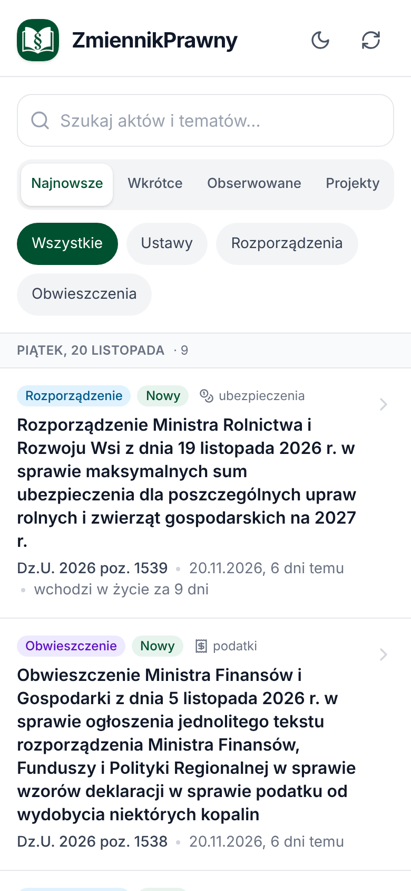
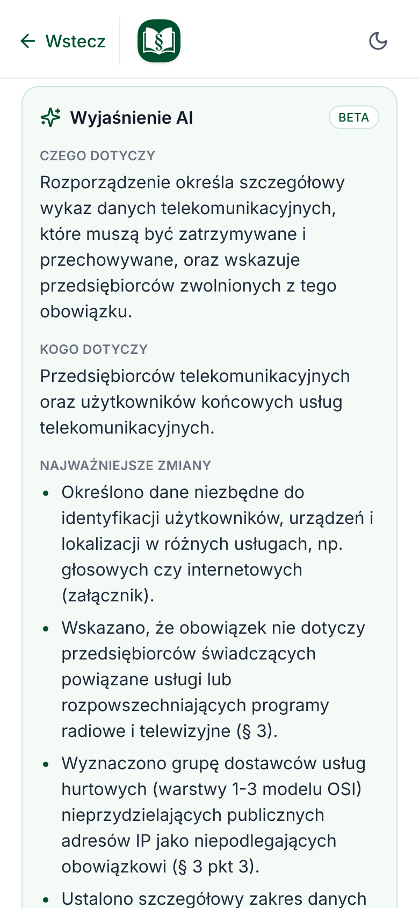
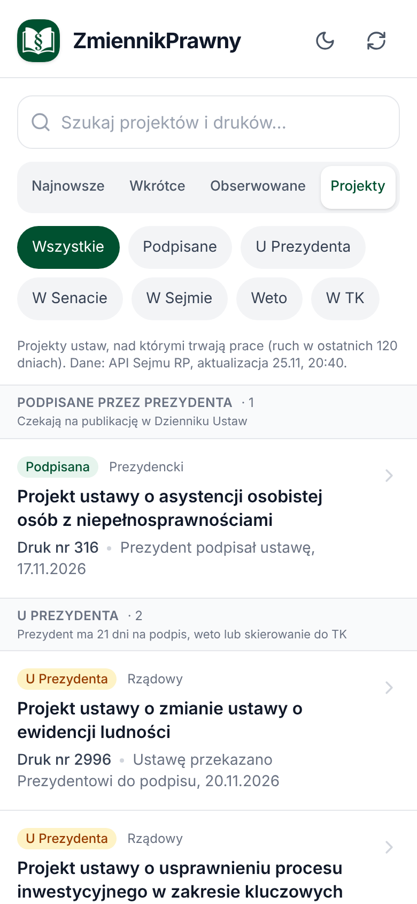

<div align="center">
  
  <h1>ZmiennikPrawny</h1>
  <p>Nowe ustawy, rozporządzenia i obwieszczenia z Dziennika Ustaw RP w jednym miejscu, zaraz po publikacji.</p>

  <p>
    
    
    
    
    
    
    
    <br />
    
    
    
  </p>

  <p>
    <a href="https://app.zmiennikprawny.pl/"></a>
    &nbsp;
    <a href="https://zmiennikprawny.pl"></a>
  </p>

  
  &nbsp;
  
  &nbsp;
  
</div>

---

**ZmiennikPrawny** – polska aplikacja internetowa z kategorii LegalTech, służąca do śledzenia nowych aktów prawnych ogłaszanych w Dzienniku Ustaw Rzeczypospolitej Polskiej. Pokazuje ustawy, rozporządzenia i obwieszczenia w formie przejrzystej listy, razem z datą wejścia w życie, organem wydającym i tematami. Każdy akt można też wyjaśnić prostym językiem dzięki AI, a osobna zakładka pokazuje projekty ustaw, które dopiero przechodzą przez Sejm, Senat i trafiają do Prezydenta. Działa w przeglądarce i jako aplikacja progresywna (PWA) na telefonie. Korzysta z publicznego API Sejmu RP. Projekt jest rozwijany od 2025 roku przez Piotra Werbowego ([@piowerb](https://github.com/piowerb)).

| | |
|---|---|
| **Typ** | aplikacja internetowa (PWA), LegalTech |
| **Autor** | Piotr Werbowy ([@piowerb](https://github.com/piowerb)) |
| **Kontakt** | [kontakt@zmiennikprawny.pl](mailto:kontakt@zmiennikprawny.pl) |
| **Początek prac** | wrzesień 2025 |
| **Pierwsze publiczne wydanie** | listopad 2025 (Beta) |
| **Aktualna wersja** | v1.3 (listopad 2026) |
| **Język interfejsu** | polski |
| **Platformy** | przeglądarka, Android, iOS (jako PWA) |
| **Technologie** | React, TypeScript, Tailwind CSS, Vite, Cloudflare Workers AI |
| **Źródło danych** | API Sejmu RP (ELI i proces legislacyjny) |
| **Licencja** | wszelkie prawa zastrzeżone |
| **Strona** | [zmiennikprawny.pl](https://zmiennikprawny.pl) |

## Spis treści

- [O projekcie](#o-projekcie)
- [Historia projektu](#historia-projektu)
- [Funkcje](#funkcje)
- [Technologie](#technologie)
- [Uruchomienie lokalne](#uruchomienie-lokalne)
- [Struktura projektu](#struktura-projektu)
- [Źródło danych (API Sejmu RP)](#źródło-danych-api-sejmu-rp)
- [ZmiennikPrawny AI](#zmiennikprawny-ai)
- [Projekty ustaw](#projekty-ustaw)
- [iPhone i PWA](#iphone-i-pwa)
- [Licencja i prawa autorskie](#licencja-i-prawa-autorskie)

## O projekcie

### Dlaczego powstał

Dziennik Ustaw jest urzędowym publikatorem, w którym ogłasza się ustawy, rozporządzenia i inne akty prawne. W samym 2026 roku do listopada opublikowano w nim ponad 1500 pozycji, czyli średnio kilka nowych aktów każdego dnia roboczego. Oficjalne serwisy, takie jak ISAP, są przede wszystkim bazami do wyszukiwania konkretnych dokumentów. Trudno w nich szybko sprawdzić, co nowego się ukazało, kiedy zacznie obowiązywać i czego dotyczy, zwłaszcza na telefonie.

ZmiennikPrawny powstał, żeby to uprościć: jedna lista nowych aktów, czytelna na telefonie, bez zakładania konta, a do tego krótkie wyjaśnienie każdego aktu prostym językiem.

### Jak działa

Przy każdym uruchomieniu aplikacja pobiera z API Sejmu RP akty opublikowane w Dzienniku Ustaw w ciągu ostatnich 30 dni. Każdy akt jest przypisywany do kategorii (ustawa, rozporządzenie, obwieszczenie), a jego słowa kluczowe stają się tematami, które można kliknąć albo obserwować. Zakładka „Wkrótce” zbiera akty wchodzące w życie w ciągu 14 dni. W szczegółach aktu można poprosić AI o wyjaśnienie: czego dotyczy, kogo dotyczy i co zmienia – zawsze z odnośnikiem do przepisu. Zakładka „Projekty” pokazuje, co dopiero nadchodzi: projekty ustaw w Sejmie, w Senacie i u Prezydenta, z oficjalnym opisem Kancelarii Sejmu i przebiegiem prac. Obserwowane tematy i ustawienia są zapisywane wyłącznie w przeglądarce użytkownika – aplikacja nie ma kont ani ciasteczek, a liczy tylko anonimowe statystyki odwiedzin (Cloudflare Web Analytics, bez ciasteczek i bez identyfikowania użytkownika).

### Dla kogo

- **Studenci prawa i aplikanci** – szybki przegląd tego, co zmienia się w prawie
- **Prawnicy i kancelarie** – kontrola nowych aktów w obszarach, którymi się zajmują
- **Przedsiębiorcy i księgowi** – śledzenie zmian w podatkach, prawie pracy i opłatach
- **Każdy obywatel** – sprawdzenie prostym językiem, jakie nowe przepisy właśnie wchodzą w życie

## Historia projektu

| Data | Wersja | Co się zmieniło |
|---|---|---|
| wrzesień 2025 | Alfa | Początek prac, wewnętrzne testy i fundamenty aplikacji |
| listopad 2025 | Beta | Pierwsza publiczna wersja, pierwsze opinie użytkowników |
| maj 2026 | v1.0 | Pierwsza wersja stabilna: dopracowany interfejs i UX |
| październik 2026 | v1.2 | Aktualizacja: zakładki „Wkrótce” i „Obserwowane”, grupowanie po dniach, linki do aktów, klikalne tematy i organy, ikonki tematów, tryb ciemny, data wejścia w życie i organ wydający z ISAP, naprawa wyszukiwarki, pełne PWA, ok. 4× mniej pobieranych danych |
| listopad 2026 | v1.3 | Wyjaśnienia AI (beta) z odnośnikami do przepisów i przyciskami „Zapytaj ChatGPT / Google AI”, zakładka „Projekty” z projektami ustaw w Sejmie, Senacie i u Prezydenta, własny backend na Cloudflare Workers, domena app.zmiennikprawny.pl, anonimowe statystyki i poprawki dostępności |

## Funkcje

- **Najnowsze akty** – ustawy, rozporządzenia i obwieszczenia z ostatnich 30 dni, pogrupowane według dnia publikacji
- **Wyszukiwarka** – szuka w tytule, sygnaturze, organie i tematach; trafione frazy są podświetlone
- **Filtry** – Wszystkie / Ustawy / Rozporządzenia / Obwieszczenia
- **Wkrótce w życie** – akty, które zaczną obowiązywać w ciągu 14 dni, z odliczaniem dni
- **Obserwowane tematy** – własna lista słów (zapisana tylko w przeglądarce, bez konta) z oznaczeniem nowych aktów od ostatniej wizyty
- **Klikalne tematy i organy** – jedno kliknięcie pokazuje wszystkie akty z danym tematem albo od danego organu; każdy temat ma swoją ikonkę
- **Wyjaśnienia AI (beta)** – w szczegółach aktu jedno kliknięcie daje streszczenie prostym językiem: czego dotyczy, kogo dotyczy i najważniejsze zmiany, każda z przepisem; daty zawsze z ISAP, nie z AI
- **Projekty ustaw** – co dopiero nadchodzi: projekty pogrupowane według etapu (podpisane, u Prezydenta, w Senacie, w Sejmie, weto, Trybunał Konstytucyjny), z oznaczeniem wnioskodawcy, trybu pilnego i wdrażania prawa UE
- **Szczegóły projektu** – opis Kancelarii Sejmu, pełny przebieg prac z datami i decyzjami, linki do sejm.gov.pl i do prac rządu w RCL, własny adres (np. `/#/projekt/10/3400`)
- **Pytania do aktu i projektu** – przyciski „Zapytaj ChatGPT” i „Zapytaj Google AI” (tryb AI w wyszukiwarce Google, oparty na Gemini) otwierają rozmowę z gotowym pytaniem o konkretny akt albo projekt
- **Szczegóły aktu** – sygnatura, data publikacji i wejścia w życie, organ, tematy, link do PDF i do strony w ISAP, kopiowanie sygnatury i linku
- **Linki do aktów** – każdy akt ma własny adres (np. `/#/DU/2026/1539`), działa przycisk „wstecz”
- **Tryb ciemny** – automatycznie według systemu albo ręcznie
- **PWA** – instalacja na ekranie głównym telefonu, dopasowanie do notcha i Dynamic Island

## Technologie

| | |
|---|---|
| Interfejs | React 18 + TypeScript |
| Style | Tailwind CSS v4 |
| Budowanie | Vite 6 |
| Ikony | Lucide React |
| Dane | API Sejmu RP (ELI) |
| AI | Cloudflare Workers AI (Gemma 4 26B, zapasowo GLM-4.7 Flash) + Workers KV |
| Backend | Cloudflare Worker: wyjaśnienia AI i projekty ustaw, harmonogram (Cron Trigger) co 15 minut |
| Statystyki | Cloudflare Web Analytics (bez ciasteczek) |
| Hosting | Vercel (aplikacja), Cloudflare Workers (backend) |

## Uruchomienie lokalne

Wymagania: **Node.js 18+** i **pnpm**.

```bash
git clone https://github.com/piowerb/ZmiennikPrawny.git
cd ZmiennikPrawny
pnpm install
pnpm run dev
```

Aplikacja będzie dostępna pod adresem `http://localhost:5173`.

Wersja produkcyjna:

```bash
pnpm run build
```

Zbudowane pliki trafią do folderu `dist/`.

## Struktura projektu

```text
src/
├── app/
│   ├── App.tsx                 # układ, zakładki, filtry, routing (#/DU/rok/pozycja, #/projekt/kadencja/druk)
│   ├── components/
│   │   ├── ActList.tsx         # lista aktów pogrupowana po dniach
│   │   ├── ActDetail.tsx       # szczegóły aktu
│   │   ├── TopicsPanel.tsx     # obserwowane tematy
│   │   ├── AiSummary.tsx       # karta „Wyjaśnienie AI”
│   │   ├── ProjectList.tsx     # projekty ustaw pogrupowane według etapu
│   │   ├── ProjectDetail.tsx   # szczegóły projektu i przebieg prac
│   │   └── ui/                 # komponenty shadcn/ui
│   ├── lib/
│   │   ├── text.tsx            # daty, kategorie, wyszukiwanie, podświetlanie
│   │   ├── topicIcon.tsx       # ikonki tematów
│   │   ├── phases.ts           # etapy projektów (nazwy, kolejność, kolory)
│   │   └── storage.ts          # zapis ustawień w przeglądarce
│   ├── services/
│   │   ├── isapService.ts      # pobieranie aktów z API Sejmu
│   │   └── projectsService.ts  # pobieranie projektów ustaw z backendu
│   └── types/
│       ├── LegalAct.ts         # typ aktu prawnego
│       └── Project.ts          # typ projektu ustawy
├── imports/                    # logo i zrzut ekranu
└── styles/                     # Tailwind i motyw
public/                         # manifest PWA i ikony
worker/
└── zp-ai-worker.js             # backend: wyjaśnienia AI i projekty ustaw (Cloudflare Worker)
docs/                           # zrzuty ekranu do README
```

## Źródło danych (API Sejmu RP)

Aplikacja korzysta z publicznego API Sejmu RP w standardzie ELI (European Legislation Identifier).

- Zapytanie używane w aplikacji: `https://api.sejm.gov.pl/eli/acts/search?publisher=DU&pubDateFrom={data}` – akty z ostatnich 30 dni, razem z datą wejścia w życie, organem wydającym i słowami kluczowymi
- Projekty ustaw: `https://api.sejm.gov.pl/sejm/term{kadencja}/processes` (lista i przebieg prac), a bieżąca kadencja z `https://api.sejm.gov.pl/sejm/term`
- PDF aktu pochodzi z ISAP, np. `https://isap.sejm.gov.pl/isap.nsf/download.xsp/WDU20260001539/O/D20261539.pdf`
- Dokumentacja: [api.sejm.gov.pl/eli_pl.html](https://api.sejm.gov.pl/eli_pl.html) i [api.sejm.gov.pl/sejm.html](https://api.sejm.gov.pl/sejm.html)
- Portal ISAP: [isap.sejm.gov.pl](https://isap.sejm.gov.pl/)

Przykład:

```bash
curl "https://api.sejm.gov.pl/eli/acts/DU/2026/1539"
```

Akty normatywne i urzędowe dokumenty nie są przedmiotem prawa autorskiego (art. 4 ustawy o prawie autorskim i prawach pokrewnych). ZmiennikPrawny nie jest serwisem Sejmu RP ani Rządowego Centrum Legislacji, a informacje w aplikacji nie stanowią porady prawnej. Wiążący jest wyłącznie tekst opublikowany w Dzienniku Ustaw.

## ZmiennikPrawny AI

Wyjaśnienia AI działają na osobnym, małym backendzie – **Cloudflare Worker** pod adresem `https://ai.zmiennikprawny.pl` (kod: [`worker/zp-ai-worker.js`](worker/zp-ai-worker.js)).

```text
Aplikacja ──► ai.zmiennikprawny.pl/summary?eli=DU/2026/1530
                 │
                 ├─ pamięć (Workers KV) ──► gotowe podsumowanie w ~0,2 s
                 │
                 └─ API Sejmu RP: PDF aktu ──► tekst ──► model AI ──► JSON ──► zapis w pamięci
```

**Jak to działa**
1. Aplikacja wysyła tylko sygnaturę aktu (np. `DU/2026/1530`) – żadnych danych użytkownika.
2. Worker sprawdza, czy podsumowanie jest już w pamięci. Jeśli tak, zwraca je od razu.
3. Jeśli nie – pobiera oficjalny PDF z API Sejmu, zamienia go na tekst i wysyła do modelu **Gemma 4 26B** z instrukcją: *odpowiadaj wyłącznie na podstawie tekstu, przy każdej zmianie podaj przepis, nie podawaj dat*.
4. Odpowiedź (czego dotyczy, kogo dotyczy, do 5 zmian) trafia do pamięci na 180 dni, więc każdy akt jest streszczany tylko raz.

**Zasady bezpieczeństwa**
- **Daty nie pochodzą z AI** – data publikacji i wejścia w życie zawsze idą z ISAP.
- **Każda zmiana ma przepis** – np. „(art. 2)” albo „(§ 3)”, żeby łatwo sprawdzić ją w źródle.
- **Zastrzeżenie przy każdym podsumowaniu** – to pomoc, a nie porada prawna.
- **Limity** – tylko akty z ostatnich 90 dni i maks. 150 nowych podsumowań dziennie; działa na darmowym planie Cloudflare, bez ryzyka kosztów.

## Projekty ustaw

Zakładka „Projekty” korzysta z tego samego Workera (`https://ai.zmiennikprawny.pl/projects`). AI nie jest tu używane – opis projektu pochodzi od Kancelarii Sejmu, a etapy z oficjalnego przebiegu prac.

```text
Cron co 15 min ──► Worker ──► API Sejmu: bieżąca kadencja ──► lista projektów ──► przebieg prac zmienionych
                                │
Aplikacja ──► /projects ◄───────┴── gotowa lista w pamięci (Workers KV), odpowiedź w ~0,1 s
```

- **Co pokazuje** – projekty, nad którymi trwają prace (ruch w ostatnich 120 dniach), oraz ustawy uchwalone, ale jeszcze nieopublikowane. Projekt znika, gdy trafi do Dziennika Ustaw – wtedy jest już na liście aktów.
- **Etapy** – W Sejmie → W Senacie → U Prezydenta → Podpisane; osobno weto i skierowanie do Trybunału Konstytucyjnego.
- **Kadencja ustalana automatycznie** – Worker sam sprawdza w API bieżącą kadencję Sejmu, więc po wyborach nic nie trzeba zmieniać. Przez pierwsze 120 dni nowej kadencji pokazuje też ustawy uchwalone w poprzedniej, które czekają na Senat, Prezydenta albo publikację (niedokończone projekty wygasają – zasada dyskontynuacji).
- **Aktualność** – harmonogram (Cron Trigger) sprawdza dane co 15 minut, a pełna lista jest odświeżana co godzinę, także bez żadnych odwiedzin.
- **Darmowy plan** – maks. 43 zapytania do API Sejmu na jedno odświeżenie (limit planu Free to 50); brakujące szczegóły dochodzą w kolejnych odświeżeniach.

## iPhone i PWA

Aplikacja działa w przeglądarce, ale można ją też dodać do ekranu głównego jak zwykłą aplikację:

1. Otwórz [app.zmiennikprawny.pl](https://app.zmiennikprawny.pl/) w Safari
2. Stuknij „Udostępnij” (kwadrat ze strzałką)
3. Wybierz „Dodaj do ekranu początkowego”

Interfejs uwzględnia notch i Dynamic Island (safe areas), ma przyciski o rozmiarze min. 44×44 px i własną ikonę na ekranie głównym.

## Licencja i prawa autorskie

**Wszelkie prawa zastrzeżone (All Rights Reserved).**

Kod źródłowy, projekt interfejsu i architektura aplikacji ZmiennikPrawny są moją wyłączną własnością.

- Możesz przeglądać ten kod wyłącznie w celach edukacyjnych i poglądowych.
- **Zabronione jest** kopiowanie, modyfikowanie, rozpowszechnianie i wykorzystywanie tego kodu (w całości lub we fragmentach) we własnych projektach, komercyjnych i niekomercyjnych, bez mojej wcześniejszej, wyraźnej zgody.

Jeśli chcesz użyć tego projektu, rozwinąć go albo wdrożyć u siebie, najpierw się ze mną skontaktuj: [kontakt@zmiennikprawny.pl](mailto:kontakt@zmiennikprawny.pl). Błędy i pomysły możesz zgłaszać w zakładce [Issues](https://github.com/piowerb/ZmiennikPrawny/issues).

### Licencje komponentów zewnętrznych

Prawa zastrzeżone dotyczą mojego kodu i projektu aplikacji. Projekt korzysta też z bibliotek open source na ich własnych licencjach, m.in. React (MIT), Radix UI (MIT), komponenty shadcn/ui (MIT), Tailwind CSS (MIT) i ikony Lucide (ISC). Ich prawa należą do autorów tych bibliotek. Wyjaśnienia AI generują modele dostępne w Cloudflare Workers AI (m.in. Gemma od Google), na warunkach tej usługi.

---

<p align="center">
  Autor: Piotr Werbowy (<a href="https://github.com/piowerb">@piowerb</a>) · <b>ZmiennikPrawny – bądź na bieżąco z prawem</b> ⚖️
  <br />
  <a href="#spis-treści">↑ Wróć na górę</a>
</p>
